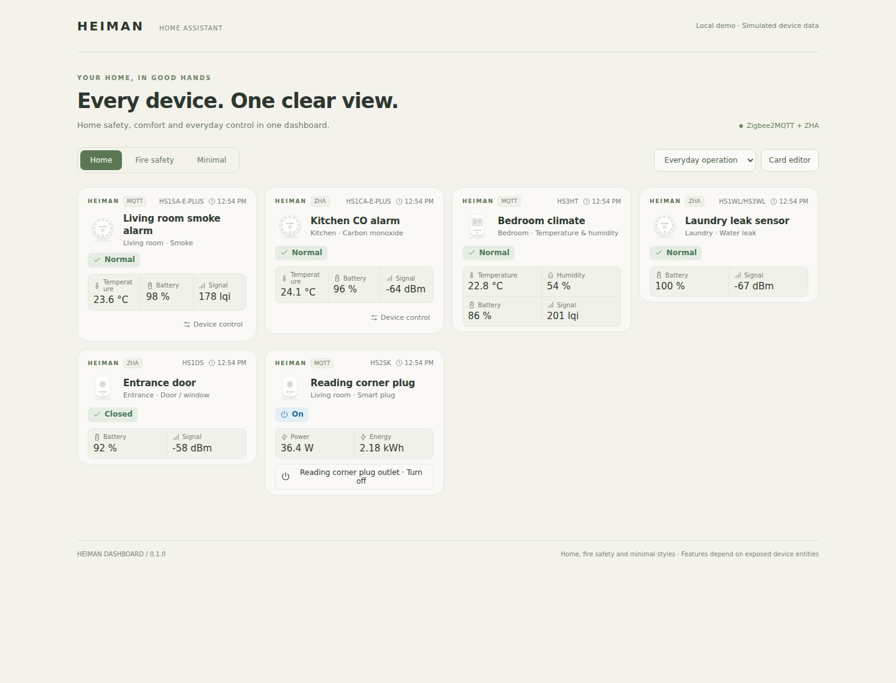
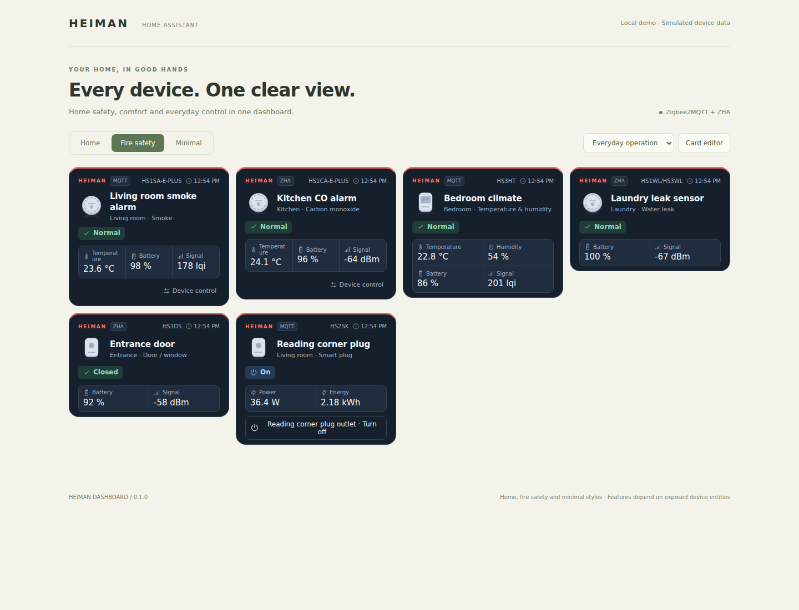

# HEIMAN Dashboard

[Device catalog](docs/SUPPORTED_DEVICES.md) · [Development](docs/ARCHITECTURE.md)


HEIMAN product cards for Home Assistant. Install with HACS, search **HEIMAN Dashboard** in **Add card**, choose your model and paired device, then choose a style. No YAML or additional card dependencies are required.





## Features

- Searchable product presets and Zigbee model aliases; one matching device is selected automatically.
- Native visual card editor with automatic or explicit language selection: Chinese, English, German, French, Spanish, Italian, Dutch, Portuguese and Polish.
- Home, fire safety and minimal styles; Home Assistant theme support and responsive layouts.
- Compact device identity, a single status badge and a shared readings strip keep more devices in view.
- Zigbee2MQTT via MQTT discovery and ZHA via native HA entities.
- Device-scoped entity matching, including multi-channel switches and logical child endpoints.
- Distinct alarm, normal, unknown, unavailable, self-test, tamper, fault and low-battery states.
- Inline indicator switches, remote self-test, temporary hush, siren start/stop, sound profiles and supported device settings.
- Unavailable devices are grey and their actuator controls are disabled.
- One bundled JavaScript file, with no CDN, cloud account or runtime network requests to HEIMAN.

## Supported devices

The **2026-11-19** catalog contains **83 product presets** from the upstream HEIMAN Zigbee2MQTT converter and matches **10 presets** to explicit upstream ZHA quirks. It includes smoke, CO, combined smoke/CO, heat and gas detectors; leak, contact, motion, fall and vibration sensors; temperature/humidity and air quality sensors; sirens, plugs, switches, relays, lights, curtains, remotes and buttons.

See the [full model table and pinned sources](docs/SUPPORTED_DEVICES.md). A preset is a UI definition, not a claim that every firmware exposes the same features. ZHA has no exhaustive device compatibility list: devices without a dedicated HEIMAN quirk can use this card when ZHA exposes suitable standard HA entities. Quirks on the upstream development branch may require a newer Home Assistant version. Hardware validation is still required before a stable release.

Pair devices through **Zigbee2MQTT or ZHA first**. For Zigbee2MQTT, enable Home Assistant MQTT discovery. This frontend card does not pair Zigbee devices, install quirks or create missing entities. It is independent of the [Heiman Home cloud integration](https://github.com/ha-china/heiman_home).

## Installation

### HACS

1. Open HACS → menu → **Custom repositories**.
2. Add `https://github.com/ha-china/heiman_dashboard` with type **Dashboard**.
3. Search for **HEIMAN Dashboard**, download, and reload the browser when prompted.
4. Edit a dashboard → **Add card** → search **HEIMAN Dashboard**.
5. Select your model. If several devices match, select the specific device. Pick a style and save.

HACS normally registers the JavaScript resource automatically for dashboards managed through the UI. If your card does not appear, check **Settings → Dashboards → Resources** in advanced mode and add:

```yaml
url: /hacsfiles/heiman_dashboard/heiman_dashboard.js
type: module
```

For YAML-managed resources, add that entry under `lovelace.resources` in your existing configuration. Restart/reload as required by your configuration. Do not create duplicate entries for the same resource.

This repository is prepared for HACS as a **Dashboard** (`plugin` in validation workflows). It has not yet been submitted to or approved for HACS's default catalog.

### Manual installation

Copy [dist/heiman_dashboard.js](dist/heiman_dashboard.js) to `/config/www/heiman_dashboard.js`, register `/local/heiman_dashboard.js` as a JavaScript module in dashboard resources, and reload your browser. The compiled file is committed so installation does not require Node.js.

## Configuration

Use the visual editor for normal setup. The following YAML is equivalent:

```yaml
type: custom:heiman-device-card
model: HS1SA-E-PLUS
device_id: your_home_assistant_device_registry_id
style: home
```

`device_id` can be omitted when exactly one device matches your model. The visual editor saves the instance when you choose a model with one match. `model: auto` identifies the model of your selected device, or selects the only supported HEIMAN device available. With several matching devices, the card asks you to choose one.

| Option          | Default     | Meaning                                                      |
| --------------- | ----------- | ------------------------------------------------------------ |
| `model`         | `auto`      | Product preset or recognized Zigbee model alias              |
| `device_id`     | Automatic   | Device registry ID; use the visual editor to select it       |
| `style`         | `home`      | `home`, `fire`, `minimal`                                    |
| `name`          | Device name | Custom title                                                 |
| `language`      | `auto`      | `auto`, `zh`, `en`, `de`, `fr`, `es`, `it`, `nl`, `pt`, `pl` |
| `show_battery`  | `true`      | Display battery measurements                                 |
| `show_signal`   | `true`      | Display signal measurements, preserving LQI/dBm units        |
| `show_controls` | `true`      | Display actual controls and device settings                  |
| `show_details`  | `true`      | Expandable entity readings and diagnostics                   |
| `entity`        | None        | Optional primary entity, also used to identify its device    |
| `entities`      | Automatic   | Advanced role → entity ID overrides                          |

For unusual discovery names, assign entities in the visual editor's **Entity assignments** section. Overrides also allow setup when registry access is unavailable:

```yaml
type: custom:heiman-device-card
model: HS1CA-E-PLUS
style: fire
entities:
  co: binary_sensor.kitchen_carbon_monoxide
  battery: sensor.kitchen_battery
```

See [src/config.ts](src/config.ts) for supported role names. Alarm roles must reference binary sensors; numeric concentration values are displayed in details and never treated as detector alarm decisions.

Switch and light buttons operate their exact HA entity. Curtain controls call native cover services. The card directly exposes indicator switches, self-test buttons, temporary hush, siren start/stop and available select/number settings. Z2M automation sound profiles use the exposed select entity; ZHA sirens use native siren services. Tone, duration and volume fields appear only when the siren advertises those capabilities. Numeric settings respect the entity's range and step.

The header places the MQTT/ZHA badge beside HEIMAN and shows the last update time. Open **Device control** for all inline controls and configuration fields in one panel, or **Details** for all entity readings. Additional settings appear directly in the control panel without a separate expander. Both panels start collapsed, share the compact action row and preserve unfinished settings when closed. Cards without either action omit that row. An active detector alarm exposes its hush action immediately; a siren reported as sounding exposes its supported stop action even with settings closed. Everyday switch, light and curtain controls remain visible.

Buttons that have never been pressed may report `unknown`; they remain usable while the device is available. A successful service request is shown as sent, while the UI waits for the integration to report the actual state. Temporary hush requests silencing; it does not offer an undocumented inverse command. Firmware updates and complex remote functions retain HA's native dialog. Disabled or hidden entities are not automatically selected. Sensor values retain the integration's units and HA formatting.

All nine languages cover the card, editor, statuses and inline controls. `auto` follows the HA user's language, including regional variants such as `de-DE`, `fr-CA` and `pt-PT`. Device names and unknown vendor-defined option names remain as provided by the integration.

To choose a language, edit the dashboard, edit the HEIMAN card, and use **Language** directly below **Card name** in the visual editor.

The default is **Follow Home Assistant** (`language: auto`). This follows the current HA user's interface language, including changes made after opening the dashboard. Unsupported or unavailable language settings fall back to English. An explicit card language overrides automatic selection; remove an old `language: zh` override or select **Follow Home Assistant** to restore automatic behavior.

Source code, comments, documentation, demo content and commit messages use English. Translated UI strings and native language names are stored in `src/locales/`.

## Troubleshooting

- **Card not found:** confirm the resource URL and module type, then refresh the browser cache. Check that the HACS repository category is Dashboard.
- **No device:** pair it first, enable MQTT discovery if using Z2M, and choose a listed model. Check the model aliases in the catalog. You can assign entities manually.
- **Several devices:** select the instance in the editor. The card does not guess between instances.
- **Unknown / unavailable:** check the main detector entities in HA. A battery reading alone does not establish detector availability; both smoke and CO channels are required for a combined detector to show normal.
- **Missing control:** confirm your integration exposes and enables the corresponding entity. A card cannot add firmware or integration capabilities.

## Development

Requires Node.js **22.21+** and npm.

```sh
npm ci
npm run check
npx playwright install --with-deps chromium
npm run test:browser
npm run dev
```

Open `http://127.0.0.1:5173` for an interactive local preview with explicitly simulated data, styles, scenarios and the real editor. Re-run the build or restart the preview after source changes. Update the product catalog with `npm run catalog:update`; review the generated changes before publishing. See [architecture](docs/ARCHITECTURE.md), [release instructions](docs/RELEASING.md) and [contributing](CONTRIBUTING.md).

## License and support

Apache-2.0; see [LICENSE](LICENSE), [NOTICE](NOTICE) and [third-party licenses](THIRD_PARTY_LICENSES.md). To report a problem, include your HA/card versions, model, integration, entity classes and reproduction steps in the repository's Issues tab. Do not include access tokens or passwords.
