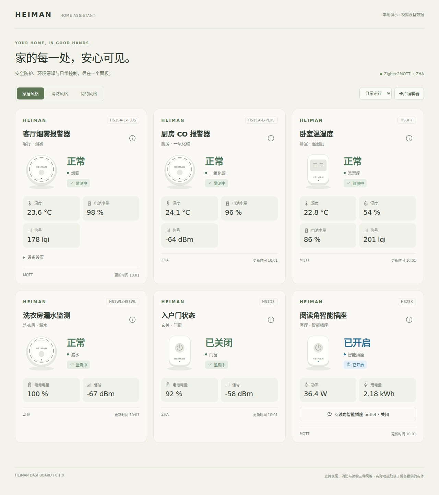
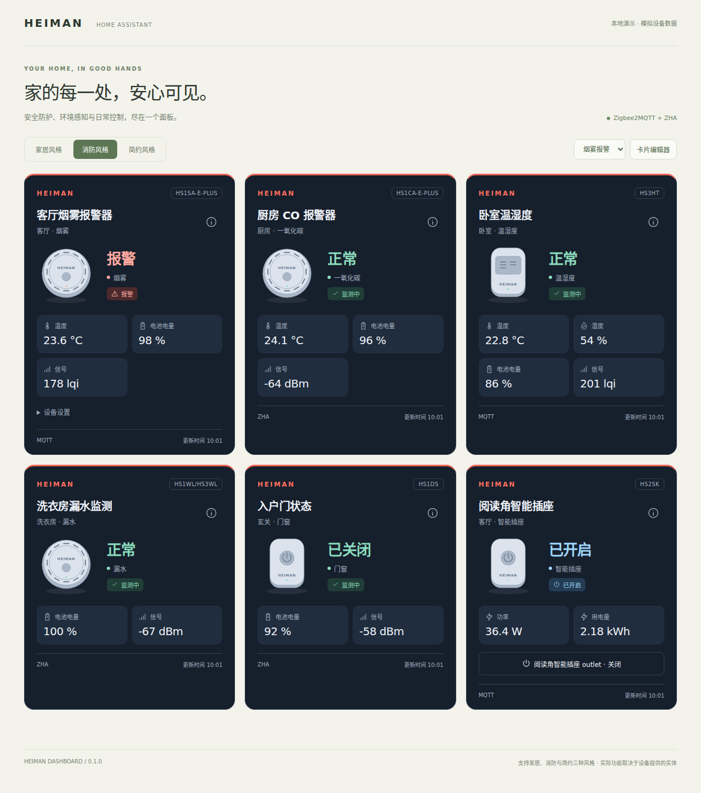

# HEIMAN Dashboard

[English](../README.md) · [完整型号与来源](../docs/SUPPORTED_DEVICES.md) · [代码架构](../docs/ARCHITECTURE.md)

为 HEIMAN 产品提供 Home Assistant 仪表盘卡片。通过 HACS 安装后，在 HA 的“添加卡片”中搜索 **HEIMAN Dashboard**，选择产品型号、对应设备和卡片样式即可完成添加，无需编写 YAML。





## 使用流程

1. 先通过 **Zigbee2MQTT 或 ZHA** 将设备接入 HA。Z2M 需要启用 Home Assistant MQTT 自动发现。
2. 在 HACS → 自定义存储库中添加 `https://github.com/ha-china/heiman_dashboard`，类型选择 **Dashboard（仪表盘）**。
3. 下载 **HEIMAN Dashboard** 并按提示刷新浏览器。
4. 编辑仪表盘 → 添加卡片 → 搜索 **HEIMAN Dashboard**。
5. 选择型号；只有一台匹配设备时自动选中，多台时选择具体设备。
6. 在**家居、消防、简约**三种风格中选择并保存。

卡片不需要额外的 Python 集成、HEIMAN 云账号或其他第三方卡片。`heiman_home` 是独立的云集成，本项目通过 Z2M/ZHA 已有的 HA 实体工作。

如未自动出现卡片，在“设置 → 仪表盘 → 资源”（需要高级模式）确认以下资源存在，类型为 JavaScript 模块：

```text
/hacsfiles/heiman_dashboard/heiman_dashboard.js
```

YAML 管理的资源需在现有 `lovelace.resources` 中手动添加该 URL 和 `type: module`。手动安装时，把 `dist/heiman_dashboard.js` 复制到 `/config/www/` 并添加 `/local/heiman_dashboard.js` 模块资源。

## 设备范围

截至 **2026-11-19** 的目录包含 Z2M 官方 HEIMAN 转换器中的 **83 个产品预设**，其中 **10 个预设**在 ZHA 官方设备处理仓库中匹配到专用 quirk。完整型号、Zigbee 别名、源码版本和逐项证据见[设备目录](../docs/SUPPORTED_DEVICES.md)。

类型包含烟感、CO、烟雾与 CO 复合、高温、燃气、水浸、门磁、人体、跌倒、振动、温湿度、空气质量、声光报警、插座、开关、继电器、灯光、窗帘、遥控器、按钮。

ZHA 没有完整的官方设备兼容清单。“已有 quirk”表示存在对应上游处理代码；“标准实体”表示 ZHA 若已提供对应 HA 实体，卡片即可显示，不代表该型号所有功能已在 ZHA 实机验证。上游开发分支中的新 quirk 也可能需要更新 HA 才可使用。不同固件与接入方式暴露的功能可能不同，卡片只显示实际提供的能力。

## 功能与状态

- 中英文随 HA 语言自动切换，也可在编辑器中指定。
- 按设备 ID 归集实体，优先识别实体设备类别与翻译键，不依赖设备名称或实体 ID 前缀。
- 保留温度、湿度、电量、功率、用电量及 LQI/dBm 等原始单位。
- 正常、报警、低电量、防拆、故障、自检、未知与不可用分别显示。
- 复合探测器缺少烟雾或 CO 任一通道时，不显示正常；已有报警始终优先显示。
- 多路开关与逻辑子设备的控制实体分别操作。
- 自检、消音、灵敏度、固件更新等配置打开 HA 原生实体详情，使用接入集成实际提供的功能。
- 实体匹配异常时，在“实体匹配设置”手动指定；无注册表权限时也可按型号指定实体。

```yaml
type: custom:heiman-device-card
model: HS1SA-E-PLUS
style: home
device_id: 你的HA设备ID
```

只有一台对应型号时可省略 `device_id`。可选项和完整示例见[英文文档](../README.md#configuration)。

## 开发与发布

仓库按 `heiman_home` 的根目录说明文档、`hacs.json`、Apache-2.0 许可证、`.github/workflows` 和中文文档组织方式建立；卡片是前端 Dashboard 插件，因此使用 TypeScript/Lit 源码、`dist/heiman_dashboard.js` 发布产物和 `category: plugin` 校验。

已提供型号目录更新脚本、单元测试、浏览器交互测试、HACS 校验工作流与版本发布工作流。运行 `npm ci && npm run check` 校验，`npm run dev` 启动本地模拟预览。浏览器测试安装方式见根目录 README。

当前为初始版本，尚待实机验收和 HACS 默认商店收录。[发布说明](../docs/RELEASING.md)列出了版本发布与审核所需步骤。
